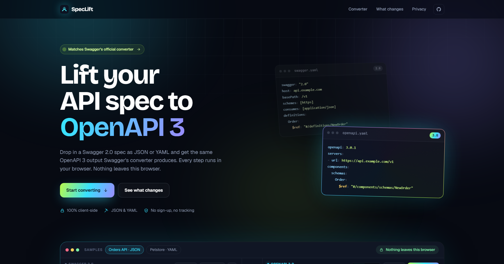
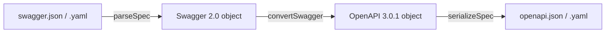

<div align="center">


# SpecLift

**Swagger 2.0 → OpenAPI 3, privately in your browser.**
Swagger's official conversion rules, minus Swagger's bugs.

[](https://github.com/dante0747/spec-lift/actions/workflows/ci.yml)
[](https://github.com/dante0747/spec-lift/actions/workflows/pages.yml)
[](#swagger-parity)
[](LICENSE)


[**Open the converter**](https://dante0747.github.io/spec-lift/) ·
[Report a bug](https://github.com/dante0747/spec-lift/issues/new?template=bug_report.yml) ·
[Request a feature](https://github.com/dante0747/spec-lift/issues/new?template=feature_request.yml)



</div>

## Why SpecLift?

API specs often describe internal systems that must not be uploaded to a
third-party service. Swagger's online converter sends your spec to its server.
SpecLift runs the same conversion entirely in your browser, and fixes the
places where Swagger's output is invalid or loses data.

|                                        | SpecLift | converter.swagger.io |
| -------------------------------------- | :------: | :------------------: |
| Spec stays on your machine             |    ✅    |  ❌ uploaded to a server |
| Same conversion rules as Swagger       |    ✅    |          ✅          |
| Byte-for-byte Swagger output available |    ✅ Swagger-exact mode | ✅ |
| Valid OpenAPI 3.0 when Swagger's isn't |    ✅    |          ❌          |
| JSON and YAML, in and out              |    ✅    |          ✅          |
| Works offline, no account, no tracking |    ✅    |          ❌          |

## Features

- **Two modes.** *Fix Swagger bugs* (default) keeps Swagger's rules and fixes
  its known bugs. *Swagger-exact* reproduces converter.swagger.io exactly, key
  order included.
- **JSON and YAML.** Paste, open, or drop `.json`, `.yaml` or `.yml` files up to
  10 MB, and copy or download the result in either format. YAML is read with
  the same YAML 1.1 rules Swagger uses.
- **A real editor.** Syntax highlighting, line numbers, error-line markers,
  formatting, live conversion as you type, and `Ctrl`/`⌘` + `Enter`.
- **Helpful checks.** Clear messages for invalid input, OpenAPI 3 documents and
  missing fields, plus a warning when output `$ref`s point to nothing.
- **Private by design.** No backend, uploads, accounts, analytics, telemetry,
  storage, third-party scripts or font CDNs.

## Quick start

Use it online at **[dante0747.github.io/spec-lift](https://dante0747.github.io/spec-lift/)**,
or run it locally (Node.js 22.13 or newer):

```bash
git clone https://github.com/dante0747/spec-lift.git
cd spec-lift
npm ci
npm run dev
```

The terminal prints the local address. Conversion still happens in your
browser.

## How it works



| File | Role |
| ---- | ---- |
| [`app/spec-format.ts`](app/spec-format.ts) | Detects JSON or YAML, parses with Swagger's YAML 1.1 rules, and serializes the result. |
| [`app/converter.ts`](app/converter.ts) | A TypeScript port of Swagger's converter (swagger-parser 2.1.22 and swagger-core), with an optional bug-fix mode. |
| [`app/converter-refs.ts`](app/converter-refs.ts) | Swagger's `$ref` classification and resolution rules. |
| [`app/page.tsx`](app/page.tsx) | The converter UI. |

The converter is a pure function with no network access:

```ts
import { convertSwagger } from "./app/converter";

const openapi = convertSwagger(swaggerDocument); // Swagger-exact
const fixed = convertSwagger(swaggerDocument, { fixSwaggerBugs: true });
```

## Swagger's bugs, fixed

With *Fix Swagger bugs* on (the default), SpecLift changes only these
behaviors and keeps everything else identical to Swagger:

| Swagger's converter | SpecLift |
| ------------------- | -------- |
| `type: file` inside schemas stays `file`, which OpenAPI 3 doesn't allow | `type: string, format: binary` |
| Date defaults and enums become `2021-01-01T00:00:00.000+00:00` | Dates stay `2021-01-01` |
| Array defaults become text such as `"[\"a\",\"b\"]"` | Real arrays |
| Numeric form-field enums become strings `["1", "5"]` | Numbers stay numbers |
| Object examples on string bodies become Java text `{a=1}` | Examples stay JSON |
| Shared parameters lose `example` and `nullable` after their first use | Every use keeps them |
| Defaults, enums, `readOnly`, `minProperties`, discriminators and some `x-` extensions are dropped | Kept |
| Operation-level `schemes` are dropped | Emitted as operation `servers` |
| Empty form-field `enum: []` is copied, which OpenAPI 3 rejects | Omitted |

How much this matters, measured on 93 real-world APIs:

- **Lost data:** fixed mode restores data Swagger drops in **45 of 93**
  specs, mostly examples on shared parameters, contact extensions, defaults
  and enums.
- **Validity:** the invalid-output bugs mainly show up in edge cases. Every
  real-world output was valid OpenAPI 3.0 in both modes, while 7 of the 31
  JSON edge-case fixtures are invalid in Swagger-exact mode. In fixed
  mode, the only invalid one is a fixture whose input already has an
  operation with no `responses`.

## Swagger parity

Swagger-exact mode is tested against converter.swagger.io, comparing the JSON
text, so key order counts:

- **99 real-world APIs** from [APIs.guru](https://apis.guru), from 1 KB to
  1 MB, were identical.
- **[`tests/fixtures/parity`](tests/fixtures/parity)** pins JSON edge cases,
  and **[`tests/fixtures/parity-yaml`](tests/fixtures/parity-yaml)** pins YAML
  reading rules (`yes`/`no`/`on`/`off` are booleans, `010` is octal, unquoted
  `version: 1.0` stays `"1.0"`). Each input is stored with Swagger's actual
  output, and `npm test` checks them all offline.
- **[`tests/fixtures/fixed`](tests/fixtures/fixed)** pins every bug fix, and
  fixed-mode output is validated against the official OpenAPI 3.0 JSON Schema.

To compare more specs, put `NAME.swagger.json` or `NAME.swagger.yaml` files in
a folder and run:

```bash
node scripts/fetch-swagger-reference.mjs <folder>   # asks converter.swagger.io
node scripts/parity-check.mjs <folder>              # compares SpecLift's output
```

[`scripts/build-apis-guru-corpus.mjs`](scripts/build-apis-guru-corpus.mjs)
downloads a sample of public Swagger 2.0 specs to use. These scripts call
converter.swagger.io; the app never does.

### Known differences

- External `$ref`s (other files or URLs) are left as they are. Swagger
  downloads them and rejects the spec if it can't.
- A parameter reused through a YAML alias (`*name`) is kept. Swagger drops it.
- JavaScript numbers can't hold integers above 2^53 exactly.
- Swagger 1.x input and Swagger's convert-from-URL option are not supported.

## Scripts

| Command | What it does |
| ------- | ------------ |
| `npm run dev` | Starts the dev server. |
| `npm run lint` | Runs ESLint. |
| `npm run typecheck` | Runs the TypeScript compiler without emitting files. |
| `npm test` | Builds the app, then runs unit, parity, YAML, fixed-mode and OpenAPI-validity tests. |
| `node scripts/oas3-validity.mjs <dir…>` | Counts invalid OpenAPI 3.0 outputs per folder, in both modes. |
| `npm run build:pages` | Builds the static site into `out/`. |

## Deploy your own

`npm run build:pages` creates a fully static site in `out/` that any static
host can serve. To build for a sub-path, set `NEXT_PUBLIC_BASE_PATH`:

```bash
NEXT_PUBLIC_BASE_PATH=/spec-lift npm run build:pages
```

To publish with GitHub Pages, open **Settings → Pages**, set **Source** to
**GitHub Actions**, and push to `main`. The
[deploy workflow](.github/workflows/pages.yml) tests, builds and publishes the
site, and works for both project sites and `username.github.io` repositories.

## Privacy model

SpecLift reads files with the browser `FileReader` API, converts the parsed
object in memory, and creates downloads from a temporary `Blob`. Conversion
makes no network requests, and fonts are bundled with the site. Hosting the
static files can still produce ordinary web-server access logs, but spec
contents never reach the host. See [SECURITY.md](SECURITY.md).

## Contributing

Issues and pull requests are welcome. See [CONTRIBUTING.md](CONTRIBUTING.md)
for the workflow and checklist, and please follow the
[code of conduct](CODE_OF_CONDUCT.md). Changes are listed in the
[changelog](CHANGELOG.md).

## License

[MIT](LICENSE) © SpecLift contributors.
